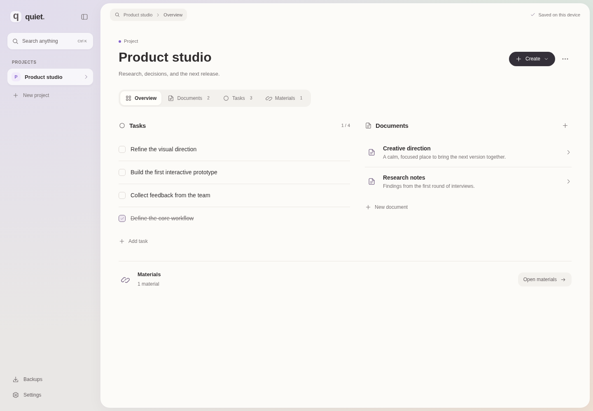

# Quiet

Персональний workspace: проєкти, завдання, документи й матеріали в одному місці. Локальні дані, швидка навігація, мінімум залежностей.



_Приклад із власним вмістом для демонстрації інтерфейсу. Новий workspace залишається порожнім._

## Можливості

- Створення, редагування й видалення проєктів.
- Редагування назв проєктів і завдань на місці: клік → Enter або перехід до іншого поля для збереження, Escape для скасування. Порожні назви не зберігаються.
- Кнопка **Створити / Create** у кожному розділі проєкту: завдання, документ, посилання або файл.
- Відновлення останнього видалення без перезапису пізніших змін.
- Завдання з фільтрами та позначкою виконання.
- Markdown-редактор, захищений перегляд і експорт `.md`.
- Посилання та вкладені файли до 5 МБ кожен.
- Пошук за назвою та вмістом у всіх проєктах: `Ctrl / ⌘ + K`.
- Автоматичне збереження та відновлення відкритого проєкту, розділу й документа.
- Експорт у JSON та перевірений імпорт із підтвердженням заміни.
- Сучасний адаптивний інтерфейс українською та англійською, системні шрифти, клавіатурна навігація.

При першому запуску workspace порожній: без прикладів проєктів, документів, завдань і матеріалів. Усе створює користувач. Оновлення з попередньої версії не видаляє наявні дані.

**Налаштування → Тема:** світла, темна або системна. Системна тема автоматично реагує на налаштування ОС. Вибір зберігається на пристрої (localStorage), окремо від даних проєктів і JSON-копій.

**Налаштування → Мова / Settings → Language:** українська або English. Вибір зберігається на пристрої, окремо від теми й даних проєктів. Перекладено інтерфейс, діалоги, підказки, повідомлення про помилки; дати, одиниці розміру та форми лічильників відповідають мові. Тексти й назви, створені користувачем, залишаються без змін. За замовчуванням — українська.

Переклад реалізовано невеликим типізованим каталогом без додаткових залежностей.

Експериментальний дизайн v0.5 натхнений [Zen](https://zen-browser.app/) та [Helium](https://helium.computer/): м’яке кольорове тло, округла робоча поверхня, компактні вкладки та стримані дії. Градієнти, іконки й оформлення локальні; нових залежностей або завантажуваних шрифтів немає.

## Щоденна робота

Бічна панель згортається кнопкою біля логотипа або `Ctrl / ⌘ + \`. У вузькій панелі залишаються проєкти, створення, пошук, резервні копії та налаштування; назви доступні в підказках. Згортання зберігає відкритий документ і фокус редактора. Вигляд панелі запам’ятовується на пристрої окремо від даних і JSON-копій. На телефоні проєкти відкриваються у звичайній висувній панелі незалежно від цього вибору. Натискання на назву розділу у верхній панелі відкриває пошук.

Натисни назву проєкту або текст завдання, щоб відредагувати його на місці. Клавіші Enter та Tab зберігають зміни, Escape скасовує. На сенсорному екрані доступна видима іконка редагування.

Кнопка **Створити / Create** працює з будь-якого розділу. Меню підтримує Enter, стрілки, Home, End та Escape. Завантаження Markdown і видалення документа доступні через меню **Дії документа / Document actions**. Ширина тексту в редакторі обмежена для зручного читання; перегляд Markdown завантажується за потреби.

Після видалення завдання, документа, матеріалу або проєкту з’являється **Повернути / Undo** на 12 секунд. Наведення, фокус із клавіатури та приховування вкладки призупиняють таймер. Відновлення повертає тільки видалені записи та зберігає нові проєкти й пізніші редагування. Доступна остання операція видалення; наступне видалення замінює її. Перезавантаження або відновлення JSON-копії очищає цю можливість. Для тривалого зберігання використовуй резервні копії.

## Codespaces

Відкрий репозиторій → **Code → Codespaces → Create codespace on main**. Конфігурація `.devcontainer` встановить Node, Rust та Linux-бібліотеки Tauri.

```bash
npm run dev
```

Відкрий порт **1420** у вкладці Ports. Залишай його приватним. Для браузерного перегляду desktop-середовище не потрібне.

Перший запуск devcontainer потребує часу на встановлення системних залежностей. Вебінтерфейс можна також запустити в будь-якому середовищі з Node 24: `npm ci && npm run dev`.

## Desktop

Потрібні Node 24, актуальний stable Rust та [системні залежності Tauri 2](https://v2.tauri.app/start/prerequisites/).

Для Ubuntu / Debian:

```bash
sudo apt-get update
sudo apt-get install -y libwebkit2gtk-4.1-dev build-essential pkg-config libxdo-dev libssl-dev librsvg2-dev libayatana-appindicator3-dev patchelf
npm ci
npm run desktop
```

Збірка інсталятора на цільовій ОС:

```bash
npm run desktop:build
```

Codespaces призначений для коду, вебперегляду та перевірки компіляції. Інтерактивну desktop-версію запускай на комп’ютері з графічним середовищем.

## Windows Releases та оновлення

Починаючи з **0.6.0**, Windows-додаток перевіряє оновлення один раз після запуску. **Налаштування → Оновлення** дозволяє перевірити вручну та натиснути **Завантажити та встановити**. Перевірка нічого не встановлює; під час завантаження можна працювати. Перед запуском інсталятора редагування блокується й завершуються поточні записи. Якщо збереження або перевірка підпису не вдалася, встановлення не запускається. Windows закриває Quiet для встановлення та запускає його знову. Дані в `app.quiet.workspace` зберігаються.

Браузерна версія не перевіряє GitHub Releases. Оновлення в цій версії підтримуються для Windows x64. Самостійна desktop-збірка без ключа показує, що оновлення не налаштовані, та продовжує працювати.

Для першого запуску й майбутніх релізів дивись **[інструкцію Releases](docs/releases.md)**. GitHub Actions спочатку створює draft із `.exe`, `.sig` та `latest.json`, перевіряє наявність і узгодженість файлів, потім публікує реліз. Неповний draft не стає доступним через канал оновлень. Релізи та файли оновлень мають бути публічно доступними.

## Зберігання

| Режим   | Сховище                                 | Розташування                                                  |
| ------- | --------------------------------------- | ------------------------------------------------------------- |
| Desktop | SQLite, WAL, транзакції, зовнішні ключі | системний app-data каталог `app.quiet.workspace/workspace.db` |
| Браузер | IndexedDB                               | поточний браузер та origin                                    |

Браузер і desktop мають **окремі дані**. Для перенесення використовуй **Резервні копії → Експортувати / Відновити**. Зміна адреси forwarded-порту створює інший browser origin. Очищення даних браузера видаляє IndexedDB; роби копії перед цим.

У репозиторій потрапляє код застосунку. Особисті дані, бази й резервні копії автоматично в GitHub не надсилаються. Серверної синхронізації, аналітики та AI API немає. Для браузерного перегляду потрібен запущений Vite або статичний вебсервер; це ще не PWA з офлайн-завантаженням.

Максимальний розмір імпортованої JSON-копії — 50 МБ. Вкладення зберігаються всередині копії в base64. Поточна версія орієнтована на невеликий персональний workspace, не на архів великих файлів. Працюй в одній вкладці: одночасне редагування між вкладками ще не узгоджується.

## Архітектура

```text
src/
  App.tsx           інтерфейс і сценарії роботи
  model.ts          типи, валідація та пошук
  storage.ts        SQLite IPC / IndexedDB, черга записів, експорт
  Markdown.tsx      ліниво завантажуваний Markdown-перегляд
  theme.ts          вибір, збереження та застосування теми
  useSidebar.ts     вигляд бічної панелі та збереження вибору
  i18n.ts           переклад, мова, локалізовані дати й лічильники
  InlineName.tsx    редагування на місці
  ActionMenu.tsx    контекстні меню з клавіатурною навігацією
  UndoNotice.tsx    відновлення після видалення
  restore.ts       повернення записів без заміни інших змін
src-tauri/
  src/model.rs      типізовані дані та перевірка зв’язків
  src/database.rs   SQLite, міграція й атомарне збереження
  src/lib.rs        Tauri-команди та системні діалоги
```

React + TypeScript + Vite; Rust + Tauri 2 + SQLite (`rusqlite`, bundled). CSS та SVG-іконки власні. Пошук працює в пам’яті за завантаженими записами. Для великих колекцій наступний крок — індекс SQLite FTS5 та читання даних за проєктом.

Нативний доступ обмежений командами workspace, відкриттям HTTP(S)-посилань та експортом у файл, обраний користувачем через системний діалог. Markdown очищається DOMPurify; віддалені зображення вимкнено. Експортовані копії не зашифровані.

## Перевірки

```bash
npm run build
npx playwright install chromium  # якщо Chromium ще не встановлено
npm test
npm run test:rust
cargo clippy --manifest-path src-tauri/Cargo.toml -- -D warnings
```

GitHub Actions перевіряє вебзбірку, браузерні сценарії, Rust-тести та компіляцію desktop із системними залежностями. Браузерні тести охоплюють збереження після перезавантаження, пошук, вкладення, резервні копії, ізоляцію проєктів, безпечний Markdown, мобільну ширину та пошкоджені дані. Окремо перевіряються згортання панелі під час редагування, збереження курсора, навігація у вузькій панелі та перехід між desktop і мобільною шириною.

## Далі

Спочатку — перевірка щоденної роботи на реальному проєкті. Потім: нативні файлові посилання та Git-контекст. Синхронізація, редактор коду й дизайн-полотно потребують окремого рішення після використання ядра.
