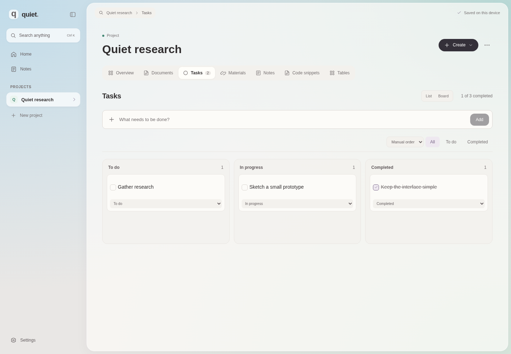

# Quiet

Персональний workspace: проєкти, завдання, документи й матеріали в одному місці. Локальні дані, швидка навігація, мінімум залежностей.



_Приклад із власним вмістом для демонстрації інтерфейсу. Новий workspace залишається порожнім._

## Можливості

- Створення, редагування й видалення проєктів.
- Редагування назв проєктів і завдань на місці: клік → Enter або перехід до іншого поля для збереження, Escape для скасування. Порожні назви не зберігаються.
- Кнопка **Створити / Create** у кожному розділі проєкту: завдання, документ, посилання або файл.
- Відновлення останнього видалення без перезапису пізніших змін.
- Завдання з фільтрами та позначкою виконання.
- Простий редактор документів: жирний, курсив, підкреслення, шрифт і розмір, заголовки, списки, вирівнювання, посилання та Undo/Redo. Експорт форматованого документа в `.html`.
- Старі Markdown-документи з переглядом, експортом `.md` і явним переходом до форматованого тексту.
- ПКМ або `Shift + F10` на проєкті, документі, завданні чи матеріалі відкриває меню дій.
- Посилання та вкладені файли до 25 МБ кожен: двійкове зберігання, стиснення без втрат і спільна копія однакового вмісту.
- Пошук за назвою та вмістом у всіх проєктах: `Ctrl / ⌘ + K`.
- Окремі звичайні нотатки з автоматичним збереженням і пошуком.
- Кожен запуск відкриває Home; логотип quiet також повертає на Home.
- Локальний перегляд PDF, DOCX і PPTX за потреби.
- Сучасний адаптивний інтерфейс українською та англійською, системні шрифти, клавіатурна навігація.

При першому запуску workspace порожній: без прикладів проєктів, документів, завдань і матеріалів. Усе створює користувач. Оновлення з попередньої версії не видаляє наявні дані.

**Налаштування → Тема:** світла, темна або системна. Системна тема автоматично реагує на налаштування ОС. Вибір зберігається на пристрої (localStorage), окремо від даних проєктів.

**Налаштування → Мова / Settings → Language:** українська або English. Вибір зберігається на пристрої, окремо від теми й даних проєктів. Перекладено інтерфейс, діалоги, підказки, повідомлення про помилки; дати, одиниці розміру та форми лічильників відповідають мові. Тексти й назви, створені користувачем, залишаються без змін. За замовчуванням — українська.

Переклад реалізовано невеликим типізованим каталогом без додаткових залежностей.

Експериментальний дизайн v0.5 натхнений [Zen](https://zen-browser.app/) та [Helium](https://helium.computer/): м’яке кольорове тло, округла робоча поверхня, компактні вкладки та стримані дії. Градієнти, іконки й оформлення локальні; нових залежностей або завантажуваних шрифтів немає.

## Модулі проєкту у 0.9

При створенні проєкту вибери модулі: завдання, документи, матеріали, нотатки, фрагменти коду та таблиці. **Стандартний набір** містить завдання, документи й матеріали; **Порожній проєкт** починається без модулів. Набір змінюється через **Меню проєкту → Редагувати проєкт**. Приховування прибирає вкладку та її блок огляду, зберігаючи весь вміст. Пошук знаходить прихований вміст і дозволяє знову ввімкнути модуль. Загальні нотатки залишаються окремими від нотаток проєктів.

- **Фрагменти коду:** назва, мова, звичайний текст і копіювання. Без виконання коду та важкого редактора.
- **Таблиці:** до 12 стовпців і 500 рядків, редагування клітинок і експорт CSV. Показуються 25 рядків за раз. Видалення непорожнього рядка або стовпця потребує підтвердження.
- **Дошка:** ті самі завдання у колонках «До роботи», «У роботі», «Виконано». Перетягуй картки або змінюй стан через список на картці. Список і дошка використовують спільні дані.

Кожна колекція проєкту має сортування за назвою, від нових або власний порядок. **ПКМ → Вище / Нижче** переміщує запис і зберігає власний порядок; у нових модулях є також кнопки переміщення вибраного запису. Проєкт запам’ятовує останню вкладку, документ, вибраний запис нового модуля, сортування, порядок і вигляд завдань. Новий запуск завжди відкриває Home.

Файли можна додавати групою або перетягувати у відкритий проєкт із модулем матеріалів. Вибрані файли завантажуються разом у ZIP із повними оригіналами; однакові назви отримують номери. Межа однієї ZIP-вибірки — 100 МБ, щоб обмежити тимчасове використання пам’яті. Архів збирається окремим Worker. Групове видалення потребує підтвердження та підтримує Undo. Окреме завантаження оригіналів залишається доступним.

Фон розтягнутий на все вікно та видимий через злегка прозору робочу поверхню. Нових залежностей у 0.9 немає.

## Щоденна робота

Бічна панель згортається кнопкою біля логотипа або `Ctrl / ⌘ + \`. У вузькій панелі залишаються проєкти, створення, Home, нотатки, пошук та налаштування; назви доступні в підказках. Згортання зберігає відкритий документ і фокус редактора. Вигляд панелі запам’ятовується на пристрої окремо від даних. На телефоні проєкти відкриваються у звичайній висувній панелі незалежно від цього вибору. Натискання на назву розділу у верхній панелі відкриває пошук.

Натисни назву проєкту або текст завдання, щоб відредагувати його на місці. Клавіші Enter та Tab зберігають зміни, Escape скасовує. На сенсорному екрані доступна видима іконка редагування.

Кнопка **Створити / Create** працює з будь-якого розділу. Меню підтримує Enter, стрілки, Home, End та Escape. Завантаження Markdown і видалення документа доступні через меню **Дії документа / Document actions**. Ширина тексту в редакторі обмежена для зручного читання; перегляд Markdown завантажується за потреби.

Після видалення завдання, документа, матеріалу або проєкту з’являється **Повернути / Undo** на 12 секунд. Наведення, фокус із клавіатури та приховування вкладки призупиняють таймер. Відновлення повертає тільки видалені записи та зберігає нові проєкти й пізніші редагування. Доступна остання операція видалення; наступне видалення замінює її. Перезавантаження очищає цю можливість.

## Документи та меню ПКМ

Новий документ одразу відкриває форматований редактор. Виділи текст і скористайся компактною панеллю: жирний, курсив, підкреслення, чотири локальні шрифти, розмір, заголовки, списки, вирівнювання, посилання та скасування/повторення редагування. Працюють `Ctrl / ⌘ + B`, `I`, `U`. Форматування й вміст зберігаються автоматично. Експорт `.html` зберігає оформлення і відкривається у браузері.

Наявні Markdown-документи не перезаписуються. **Дії документа → Форматований текст** переводить вибраний документ у візуальний редактор. До переходу залишаються Markdown-редактор і експорт `.md`. HTML при вставленні, перегляді й експорті очищається; віддалені зображення, скрипти та сторонні стилі не завантажуються. Редагування використовує вбудований механізм Chromium/WebView2 без додаткового редакторного фреймворку.

ПКМ на записі або `Shift + F10` на сфокусованому елементі відкриває відповідні дії. Перейменування працює для проєктів, документів, завдань і матеріалів. Є відкриття, завантаження/експорт, позначка виконання та видалення. Для проєкту видалення потребує підтвердження; усі видалення підтримують **Повернути / Undo**. Меню підтримує стрілки, Home, End та Escape, вміщується у вікно й працює також зі згорнутою панеллю. У полі редагування тексту залишається стандартне меню браузера.

## Вкладення та перегляд у 0.8

Вміст файлів зберігається окремо від записів проєкту: SQLite BLOB на desktop та Blob у IndexedDB браузера. SHA-256 визначає однаковий вміст; кілька матеріалів можуть посилатися на одну фізичну копію. Нові вкладення стискаються gzip із максимальним рівнем 9; у браузері це виконує окремий Worker. Якщо стиснення збільшує файл, зберігається оригінал. PDF, DOCX, PPTX і зображення часто вже стиснуті, тому виграш може бути малим. Завантаження завжди повертає повний оригінал; розмір і SHA-256 перевіряються перед відкриттям. Ліміт одного файлу — 25 МБ.

PDF відкривається локальним переглядачем браузера або Windows WebView2. DOCX/PPTX читаються невеликим модулем, який завантажується лише при відкритті: текст, базове оформлення, таблиці DOCX, слайди PPTX і локальні зображення. Складна верстка, діаграми, SmartArt і анімації Office можуть відображатися спрощено. Віддалені зображення й зовнішні зв’язки не завантажуються. Є обмеження розпакованих частин і складності документа; оригінал можна завантажити навіть коли перегляд недоступний. Після закриття перегляду тимчасові Blob URL звільняються.

Старі base64-вкладення автоматично переносяться в двійкове сховище перед збереженням нових посилань. Невикористані двійкові записи старші за добу прибираються під час наступного запуску; у поточному сеансі видалений файл залишається доступним для Undo. SQLite повертає великі обсяги вільних сторінок під час обслуговування. Схема SQLite — 4, IndexedDB — 3. Ці версії захищають нові дані модулів від перезапису старішими застосунками. Міграція з попередніх версій зберігає документи та вкладення. Працюй в одній вкладці.

**Налаштування → Фон:** стандартний, Світанок, Ліс, Лаванда або Океан. М’які статичні градієнти без завантаження фотографій та постійного GPU-розмиття. Вибір фону зберігається окремо від теми й мови.

## Codespaces

Відкрий репозиторій → **Code → Codespaces → Create codespace on main**. Конфігурація `.devcontainer` встановить Node, Rust та Linux-бібліотеки Tauri.

```bash
npm run dev
```

Відкрий порт **1420** у вкладці Ports. Залишай його приватним. Для браузерного перегляду desktop-середовище не потрібне.

Перший запуск devcontainer потребує часу на встановлення системних залежностей. Вебінтерфейс можна також запустити в будь-якому середовищі з Node 24: `npm ci && npm run dev`.

## Desktop

Потрібні Node 24, актуальний stable Rust та [системні залежності Tauri 2](https://v2.tauri.app/start/prerequisites/).

Для Ubuntu / Debian:

```bash
sudo apt-get update
sudo apt-get install -y libwebkit2gtk-4.1-dev build-essential pkg-config libxdo-dev libssl-dev librsvg2-dev libayatana-appindicator3-dev patchelf
npm ci
npm run desktop
```

Збірка інсталятора на цільовій ОС:

```bash
npm run desktop:build
```

Codespaces призначений для коду, вебперегляду та перевірки компіляції. Інтерактивну desktop-версію запускай на комп’ютері з графічним середовищем.

## Windows Releases та оновлення

Починаючи з **0.6.0**, Windows-додаток перевіряє оновлення один раз після запуску. **Налаштування → Оновлення** дозволяє перевірити вручну та натиснути **Завантажити та встановити**. Перевірка нічого не встановлює; під час завантаження можна працювати. Перед запуском інсталятора редагування блокується й завершуються поточні записи. Якщо збереження або перевірка підпису не вдалася, встановлення не запускається. Windows закриває Quiet для встановлення та запускає його знову. Дані в `app.quiet.workspace` зберігаються.

Браузерна версія не перевіряє GitHub Releases. Оновлення в цій версії підтримуються для Windows x64. Самостійна desktop-збірка без ключа показує, що оновлення не налаштовані, та продовжує працювати.

Для першого запуску й майбутніх релізів дивись **[інструкцію Releases](docs/releases.md)**. GitHub Actions спочатку створює draft із `.exe`, `.sig` та `latest.json`, перевіряє наявність і узгодженість файлів, потім публікує реліз. Неповний draft не стає доступним через канал оновлень. Релізи та файли оновлень мають бути публічно доступними.

## Зберігання

| Режим   | Сховище                                 | Розташування                                                  |
| ------- | --------------------------------------- | ------------------------------------------------------------- |
| Desktop | SQLite, WAL, транзакції, зовнішні ключі | системний app-data каталог `app.quiet.workspace/workspace.db` |
| Браузер | IndexedDB                               | поточний браузер та origin                                    |

Браузер і desktop мають **окремі дані**. Зміна адреси forwarded-порту створює інший browser origin. Очищення даних браузера видаляє IndexedDB. Інтерфейс резервних копій прибрано.

У репозиторій потрапляє код застосунку. Особисті дані й бази автоматично в GitHub не надсилаються. Серверної синхронізації, аналітики та AI API немає. Для браузерного перегляду потрібен запущений Vite або статичний вебсервер; це ще не PWA з офлайн-завантаженням.

Поточна версія орієнтована на персональний workspace. Працюй в одній вкладці: одночасне редагування між вкладками ще не узгоджується.

## Архітектура

```text
src/
  App.tsx           інтерфейс і сценарії роботи
  projectKit.ts     модулі, сортування, порядок і перевірка даних
  ProjectModules.tsx нотатки проєкту, код і прості таблиці
  TaskBoard.tsx     дошка зі спільними записами завдань
  archiveExport.ts  групове завантаження оригіналів у ZIP через Worker
  model.ts          типи, валідація та пошук
  storage.ts        SQLite IPC / IndexedDB, черга записів, міграція
  attachments.ts    стиснення та дедуплікація
  localDatabase.ts  схема IndexedDB і двійкові записи
  RichEditor.tsx    форматований редактор і захищений перегляд
  documentHtml.ts   санітизація, текст для пошуку та HTML-експорт
  ContextMenu.tsx   меню ПКМ і перейменування
  Markdown.tsx      ліниво завантажуваний Markdown-перегляд
  theme.ts          вибір, збереження та застосування теми
  useSidebar.ts     вигляд бічної панелі та збереження вибору
  i18n.ts           переклад, мова, локалізовані дати й лічильники
  InlineName.tsx    редагування на місці
  ActionMenu.tsx    контекстні меню з клавіатурною навігацією
  UndoNotice.tsx    відновлення після видалення
  restore.ts       повернення записів без заміни інших змін
src-tauri/
  src/model.rs      типізовані дані та перевірка зв’язків
  src/database.rs   SQLite, міграція й атомарне збереження
  src/attachments.rs двійкові файли, gzip, SHA-256 та очищення
  src/lib.rs        Tauri-команди та системні діалоги
```

React + TypeScript + Vite; Rust + Tauri 2 + SQLite (`rusqlite`, bundled). CSS та SVG-іконки власні. Пошук працює в пам’яті за завантаженими записами. Для великих колекцій наступний крок — індекс SQLite FTS5 та читання даних за проєктом.

Нативний доступ обмежений командами workspace, відкриттям HTTP(S)-посилань та експортом у файл, обраний користувачем через системний діалог. Markdown очищається DOMPurify; віддалені зображення вимкнено. Локальна база не зашифрована.

## Перевірки

```bash
npm run build
npx playwright install chromium  # якщо Chromium ще не встановлено
npm test
npm run test:rust
cargo clippy --manifest-path src-tauri/Cargo.toml -- -D warnings
```

GitHub Actions перевіряє вебзбірку, браузерні сценарії, Rust-тести та компіляцію desktop із системними залежностями. Браузерні тести охоплюють збереження після перезавантаження, пошук, вкладення й оригінальні завантаження, нотатки, Home, перегляд Office/PDF, фони, ізоляцію проєктів, безпечний Markdown, мобільну ширину та пошкоджені дані. Окремо перевіряються згортання панелі під час редагування, збереження курсора, навігація у вузькій панелі та перехід між desktop і мобільною шириною.

## Далі

Спочатку — перевірка щоденної роботи на реальному проєкті. Потім: нативні файлові посилання та Git-контекст. Синхронізація, редактор коду й дизайн-полотно потребують окремого рішення після використання ядра.
